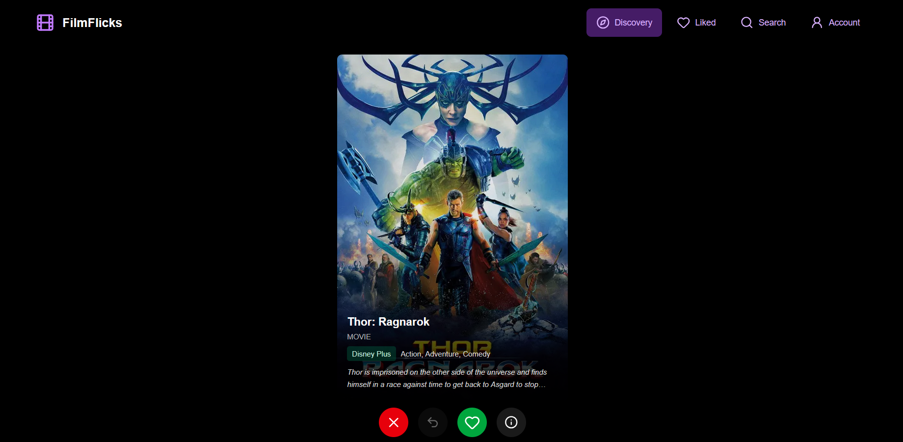
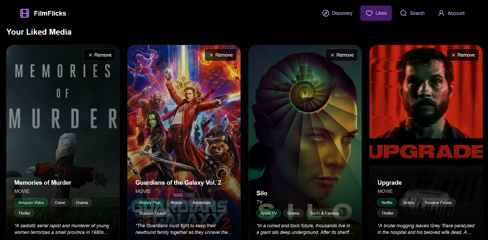
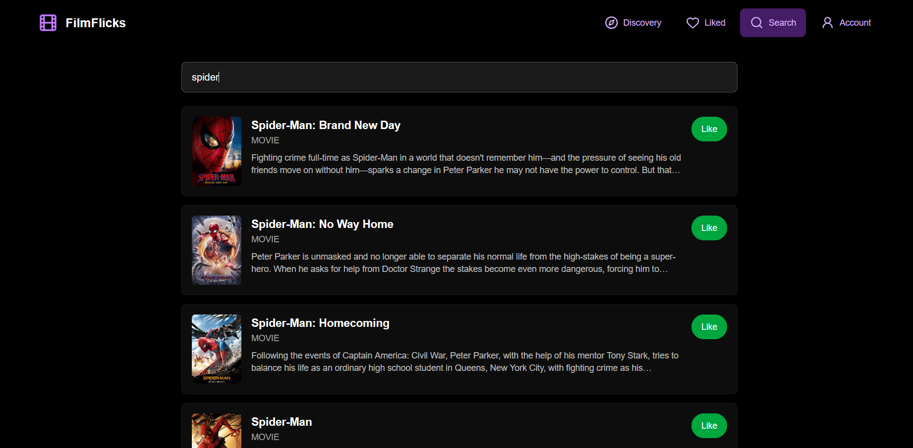
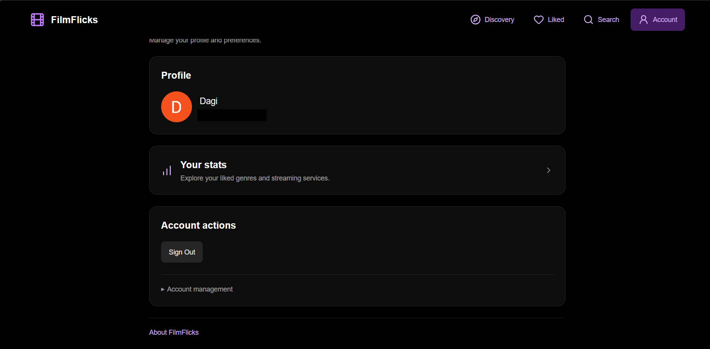
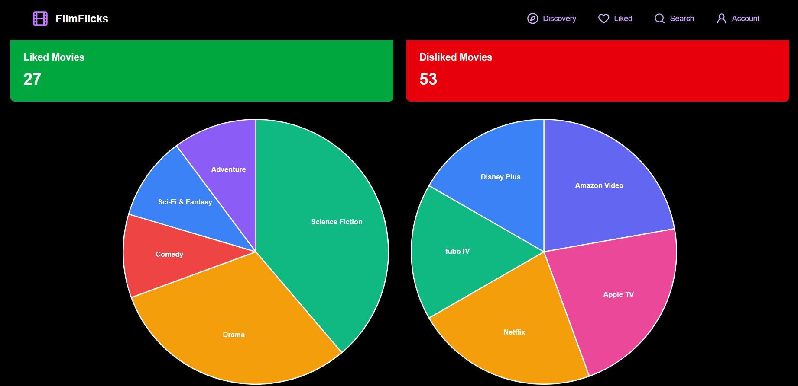

# FilmFlicks

A media discovery app for movies, TV shows, and anime, with personalized recommendations based on genre preferences and user feedback.

[Website](https://filmflicks.dagmawidelelegne.com)

## Features

- Genre onboarding and content-based recommendations using cosine similarity across genres, keywords, and overviews.
- Likes, dislikes, undo, and a small recommendation queue that excludes already queued titles.
- Anime-aware preferences, release-period signals, and exploration for more varied recommendations.
- Search and liked-media pages with posters, details, streaming availability, and pagination.
- Personal statistics for liked genres, streaming services, and feedback totals.
- Google sign-in, account management, account deletion, and a public About page with data-source credits.

## Tech stack

- **Frontend:** Next.js, React, TypeScript, Tailwind CSS, NextAuth.
- **Backend:** Python, FastAPI, SQLAlchemy, scikit-learn.
- **Database:** PostgreSQL 16.
- **Deployment:** Docker Compose on AWS EC2, Caddy HTTPS, GitHub Actions, GHCR, and AWS Systems Manager.

The current backend entry point is `backend/api_server_pg.py`. Older SQLite and CSV utilities remain from the original version.

## Run locally with Docker

Start Docker Desktop's Linux engine. You will also need a Google OAuth client and, to collect a new catalog, a TMDB API read access token.

```bash
git clone --branch pre_deployment_prep https://github.com/DagmawiDelelegne/FilmFlicks.git
cd FilmFlicks
```

### 1. Configure local environment files

Create `backend/.env`:

```dotenv
INTERNAL_API_SECRET=replace-with-a-long-random-secret
FRONTEND_URL=http://localhost:3000
TMDB_ACCESS_TOKEN=your-tmdb-read-access-token
```

Create `frontend/.env.local`:

```dotenv
NEXTAUTH_SECRET=replace-with-a-different-long-random-secret
AUTH_GOOGLE_ID=your-google-client-id
AUTH_GOOGLE_SECRET=your-google-client-secret
BACKEND_INTERNAL_SECRET=use-the-same-value-as-INTERNAL_API_SECRET
```

Use the same internal secret in both files. Compose supplies the database connection, backend URL, and local NextAuth URL. Configure Google's OAuth redirect URI as `http://localhost:3000/api/auth/callback/google`. Keep environment files out of Git.

### 2. Build and initialize PostgreSQL

Run these commands from the repository root:

```bash
docker compose build backend frontend
docker compose up -d --wait postgres
docker compose run --rm --no-deps backend python create_tables.py
```

### 3. Load the media catalog

Catalog JSON files are generated locally and are not included in Git. Put `movies.json` and `shows.json` in `backend/media_collection/data/`. To collect them from TMDB, first create that directory, then run:

```bash
docker compose run --rm --no-deps -v ./backend/media_collection/data:/app/media_collection/data backend python media_collection/collect_media.py
```

Import the files and start the app:

```bash
docker compose run --rm --no-deps -v ./backend/media_collection/data:/app/media_collection/data:ro backend python import_media.py
docker compose up -d
```

Open the [app](http://localhost:3000), [API docs](http://localhost:8001/docs), or [pgAdmin](http://localhost:5052). The importer skips existing `(media_type, tmdb_id)` records.

After changing application code, rebuild the affected containers:

```bash
docker compose up -d --build backend frontend
```

## Deployment

[GitHub Actions](.github/workflows/ci.yml) runs backend tests, frontend lint/type checks, frontend tests, and a production build. Pushes to `pre_deployment_prep` also publish commit-tagged images to GHCR and deploy to EC2 through AWS Systems Manager.

[The deployment script](scripts/deploy.sh) backs up PostgreSQL and the previous configuration, checks container health, and attempts an app rollback if startup fails. Production uses `docker-compose.production.yml`, `Caddyfile`, and a private `.env.production` on the server.

## Screenshots






## Data sources

Movie, TV, and anime metadata and posters come from [TMDB](https://www.themoviedb.org/). Streaming availability data is provided by [JustWatch](https://www.justwatch.com/) through TMDB.

This product uses the TMDB API but is not endorsed or certified by TMDB.

## Contributors

FilmFlicks started as a collaborative group project developed by:

- [Dagmawi Delelegne](https://github.com/DagmawiDelelegne)
- [Adrien Baumert](https://github.com/abaumer1)
- [Phillip Henry](https://github.com/phenry3)
- [Abdullah Gill](https://github.com/GillAbdullah)
- [Nate Von Hagen](https://github.com/NateVonHagen)
- [Kamal Korabathina](https://github.com/kkoraba1)

### Continued development

After the initial group project, I continued developing FilmFlicks with the PostgreSQL migration, recommendation improvements, account features, and AWS deployment and CI/CD setup. The original app's features were developed collaboratively.
